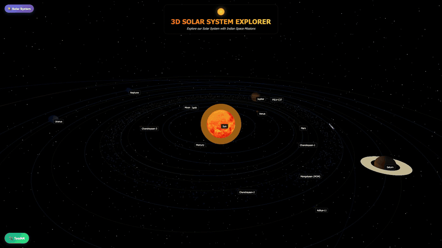

# 3D Solar System Explorer

An interactive 3D model of our solar system that runs in the browser, built with **Three.js** and **Vite**. Fly around the Sun, tap any planet for facts, and follow **India's space missions**.

[](docs/demo.mp4)

▶ [Watch the full 20-second demo with sound](docs/demo.mp4)

## Features

- **The Sun and 8 planets**, plus the Moon and Pluto, with real textures and animated orbits
- **Indian space missions:** Chandrayaan-1, 2 and 3, Mangalyaan (MOM), Aditya-L1 and PSLV-C37, plus Voyager 1
- **Info panel:** tap any object for a short description, stats and "Did you know?" facts
- **Menu** grouped into planets, moons, spacecraft and others
- **Toolkit:** pause / play, time speed slider, search, orbit lines and labels on/off
- **Keyboard shortcuts:** `Space` pause · `O` orbits · `L` labels · `R` reset view · `F` fullscreen · `+` / `-` zoom
- Live FPS counter

## Run locally

```bash
npm install
npm run dev       # start the dev server
npm run build     # production build in dist/
npm run preview   # serve the build
```

## Tech

Three.js (WebGL) · Vite · plain JavaScript and CSS
